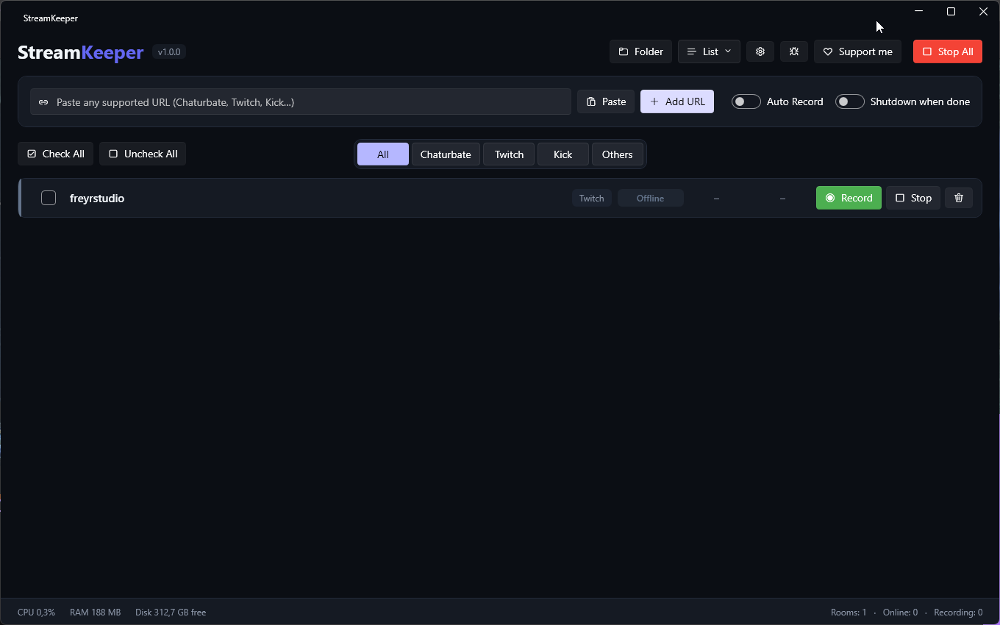
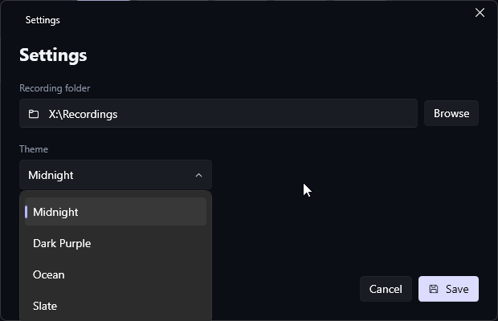

<p align="center">
  
</p>

<h1 align="center">StreamKeeper</h1>

<p align="center">
  A modern Windows app that watches live streams and records them automatically.<br>
  Chaturbate · Twitch · Kick
</p>

<p align="center">
  
</p>

---

## Features

- **Live monitoring** – rooms are checked every 30 seconds (Online, Private, Away, Offline)
- **Auto Record** – tick a room, turn on Auto Record, and it starts recording as soon as the room goes live
- **Smart stop** – stops right away when a room goes private, and after 90 seconds of confirmed offline/away
- **Auto restart** – if the stream drops for a moment, recording resumes on its own (up to 15 times)
- **Clean MP4 files** – recorded as `.ts` for safety, converted to a real `.mp4` (no re-encoding, no quality loss) when it ends
- **One folder per platform**, files named `username_YYYY-MM-DD_HH-MM-SS.mp4`
- **Live sorting** – recording and online rooms always stay at the top
- **Platform tabs** – All, Chaturbate, Twitch, Kick, Others
- **Export / Import** your room list as `.json` (handy to move it to another PC)
- **Shutdown when done** – turns the PC off when the last recording ends (with a cancel button)
- **4 themes** – Midnight, Dark Purple, Ocean, Slate, switchable live
- **Status bar** – CPU and RAM used by recordings, free disk space, room counters

<p align="center">
  
</p>

## Installation

1. Download the latest `StreamKeeper-vX.Y.Z-win-x64.zip` from the [Releases](../../releases) page
2. Unzip it anywhere (keep the `tools` folder next to `StreamKeeper.exe`)
3. Run `StreamKeeper.exe`

No .NET installation needed, everything is included.

Your room list and settings are stored in `%LOCALAPPDATA%\StreamKeeper`.
Recordings go to `Videos\StreamKeeper` by default (change it in Settings).

## Tips

- If recordings suddenly stop working after a site update, update yt-dlp: close StreamKeeper and run `tools\yt-dlp.exe -U` from the app folder.
- Status detection is most precise on Chaturbate. Kick sometimes blocks automated requests: the room then shows *Unknown*, but manual recording still works.

## Build from source

Requirements: Windows 10/11 and the [.NET 8 SDK](https://dotnet.microsoft.com/download/dotnet/8.0).

```powershell
git clone https://github.com/freyr-studio/streamkeeper.git
cd streamkeeper
.\build-release.ps1
```

The script downloads yt-dlp and ffmpeg, builds a self-contained exe and creates the zip in `release\`.

For development: `cd src` then `dotnet run` (put `yt-dlp.exe` and `ffmpeg.exe` in `src\tools` first).

Built with C# / WPF, [WPF-UI](https://github.com/lepoco/wpfui), [CommunityToolkit.Mvvm](https://github.com/CommunityToolkit/dotnet), [yt-dlp](https://github.com/yt-dlp/yt-dlp) and [FFmpeg](https://ffmpeg.org).

## Disclaimer

StreamKeeper is meant for personal use. Respect the terms of service of each platform, the rights of the streamers, and the laws of your country. Do not redistribute recordings without the creator's consent.

## Support

If StreamKeeper is useful to you, you can support its development on **[Tipeee](https://tipeee.com/freyrstudio)** ❤️

Found a bug? Open an [issue](../../issues).
